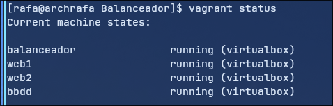

# Tarea Balanceador

## Vagrantfile
Creamos el **vagrantfile** especificando que vamos a crear 4 maquinas virtuales con Debian 12
- **Balanceador** Reparte las peticiones de los clientes entre web 1 y web 2
- **Web1 y Web2** Son los 2 servidores web son identicas, solo cambia el nombre y las IPs, por eso las creamos con un bucle
- **Base de datos** Se comparte con las 2 webs, para que los datos sean los mismo

** Hacemos un `vagrant up` y luego un `vagrant status` y debería acabar así**

