# Tarea Balanceador

## Vagrantfile
Creamos el **vagrantfile** especificando que vamos a crear 4 maquinas virtuales con Debian 12
- **Balanceador** Reparte las peticiones de los clientes entre web 1 y web 2
- **Web1 y Web2** Son los 2 servidores web son identicas, solo cambia el nombre y las IPs, por eso las creamos con un bucle
- **Base de datos** Se comparte con las 2 webs, para que los datos sean los mismo


#### Hacemos un `vagrant up` y luego un `vagrant status` y debería acabar así


### Conexión 

Nos conectamos por ssh a cada maquina de esta manera
`vagrant ssh "NOMBRE DE LA MAQUINA"`
El nombre de la maquina aparece en el vagrant status que hemos echo antes

Yo como uso el terminal de kitty me da algunos problemas con ssh entonces para poder usar clear y demás en la terminal de ssh pongo esto `export TERM=xterm-256color`

Hacemos un `ip -br a` para comprobar que todas las maquinas estan en las redes que necesitamos y esta todo en orden según hemos configurado en el vagrantfile

Haremos unos ping en web1 y en el balanceador
### Web1
`ping -c 2 10.10.1.10`
`ping -c 2 10.10.2.20`

### Balanceador
`ping -c 2 10.10.2.20`

Los de web 1 deberán funcionar correctamente y del balanceador fallará


## Base de datos`

En la maquina virtual de la base de datos instalaremos MariaDB

`sudo apt update`
`sudo apt install -y mariadb-server`

**Comprobación**
`systemclt status mariadb`
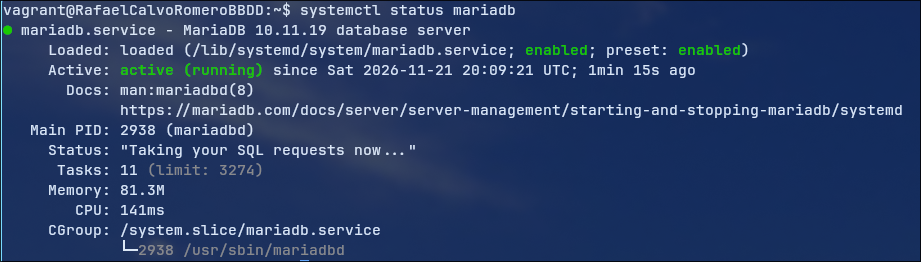

## Configuración red privada
Por defecto MariaDB solo acepta conexiones desde localhost esto es un problema porque las webs no se podrán conectar, la pondremos a escuchar su ip de red_bbdd

Entramos en este fichero `/etc/mysql/mariadb.conf.d/50-server.cnf` y buscamos esta linea
`bind-address            = 127.0.0.1` 
Cambiamos la ip de localhost por esta `10.10.2.20`

**REINICIAMOS MARIADB**
`sudo systemctl restart mariadb`

Hacemos la comprobación de que ha funcionado


En el terminal ponemos `sudo mariadb` dentro ejecutamos esto, cambiamos los asteriscos por una clave real
`CREATE DATABASE app_balanceador;`

`CREATE USER 'usuario_web'@'10.10.2.%' IDENTIFIED BY '********';`

`GRANT SELECT, INSERT ON app_balanceador.* TO 'usuario_web'@'10.10.2.%';`

`FLUSH PRIVILEGES;`

`USE app_balanceador;`

`CREATE TABLE visitas (`

`    id INT AUTO_INCREMENT PRIMARY KEY,`

`    servidor VARCHAR(50) NOT NULL,`

`    fecha DATETIME DEFAULT CURRENT_TIMESTAMP`

`);`

`EXIT;`

Comprobamos que todo esta en orden con este comando `sudo mariadb -e "SELECT user, host FROM mysql.user; SHOW TABLES FROM app_balanceador;"`


## Probar conexión web1
Desde el terminal de **web1** pondremos los siguientes comandos
`sudo apt update`

`sudo apt install -y mariadb-client`

`mariadb -h 10.10.2.20 -u usuario_web -p -e "SHOW TABLES FROM app_balanceador;"`

Pedirá la contraseña y una vez se la demos nos saldra lo siguiente:
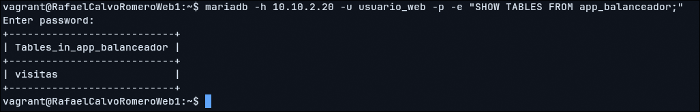


## Configuración Web1, Web2
**TODA LA CONFIGURACIÓN SE DEBE HACER EN AMBAS MAQUINAS**

Descargamos Apache y PHP
`sudo apt install -y apache2 php libapache2-mod-php php-mysql`

Comprobamos la instalación
`systemctl status apache2`

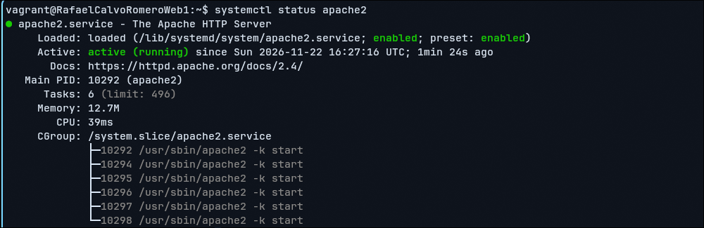
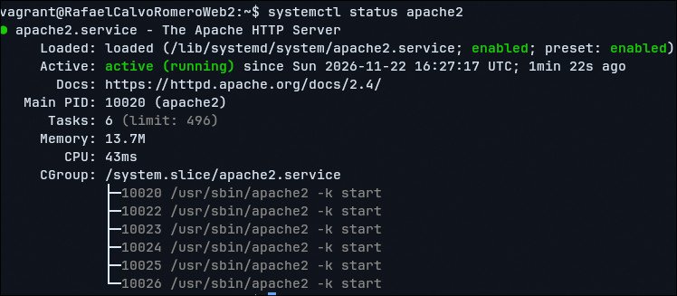

### Archivo con los datos de conexión
`sudo nano /var/www/config.php`

Pondremos esto dentro del archivo
`<?php
$db_host = "10.10.2.20";
$db_user = "usuario_web";
$db_pass = "La misma contraseña que en la base de datos";
$db_name = "app_balanceador";`

### Página de la aplicación

1º Borramos la pagina por defecto de Apache
`sudo rm /var/www/html/index.html`

2º Creamos un archivo nuevo
`sudo nano /var/www/html/index.php`

```<?php

require '/var/www/config.php';

$servidor = gethostname();

try {
    $conexion = new mysqli($db_host, $db_user, $db_pass, $db_name);

    $sentencia = $conexion->prepare("INSERT INTO visitas (servidor) VALUES (?)");
    $sentencia->bind_param("s", $servidor);
    $sentencia->execute();

    $total = $conexion->query("SELECT COUNT(*) FROM visitas")->fetch_row()[0];
    $ultimas = $conexion->query("SELECT servidor, fecha FROM visitas ORDER BY id DESC LIMIT 5");
} catch (mysqli_sql_exception $e) {
    die("Error al conectar con la base de datos.");
}
?>
<!DOCTYPE html>
<html lang="es">
<head>
    <meta charset="UTF-8">
    <title>Práctica balanceador - Rafael Calvo Romero</title>
    <style>
        body { font-family: sans-serif; background: #1e293b; color: #f1f5f9; text-align: center; padding: 40px; }
        h1 span { color: #38bdf8; }
        table { margin: 20px auto; border-collapse: collapse; }
        td, th { border: 1px solid #475569; padding: 8px 16px; }
    </style>
</head>
<body>
    <h1>Te ha respondido: <span><?= htmlspecialchars($servidor) ?></span></h1>
    <p>Visitas totales registradas en la base de datos: <strong><?= $total ?></strong></p>
    <h2>Últimas visitas</h2>
    <table>
        <tr><th>Servidor</th><th>Fecha</th></tr>
        <?php while ($fila = $ultimas->fetch_assoc()): ?>
        <tr><td><?= htmlspecialchars($fila['servidor']) ?></td><td><?= $fila['fecha'] ?></td></tr>
        <?php endwhile; ?>
    </table>
</body>
</html>
```

Descargamos curl ya que en la imagen de debian que usa vagrant no viene descargado.
`sudo apt install -y curl`

Ahora comprobamos desde cada web 
`curl -s localhost | grep respondido`

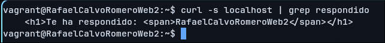

Hacemos la prueba desde el balanceador
`sudo apt install -y curl`
`curl -s 10.10.1.11 | grep respondido`
`curl -s 10.10.1.12 | grep respondido`
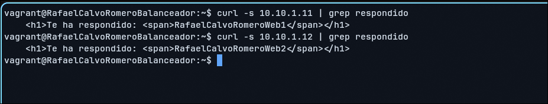


## Configuración Balanceador

### Instalamos Apache y activamos los modulos de balanceo
`sudo apt install -y apache2`
`sudo a2enmod proxy proxy_http proxy_balancer lbmethod_byrequests`

### Creamos la configuración del balanceador
Creamos un nuevo archivo
`sudo nano /etc/apache2/sites-available/balanceador.conf`

```
<VirtualHost *:80>
    ServerName localhost

    <Proxy "balancer://webs">
        BalancerMember "http://10.10.1.11"
        BalancerMember "http://10.10.1.12"
        ProxySet lbmethod=byrequests
    </Proxy>

    ProxyPreserveHost On
    ProxyPass        "/" "balancer://webs/"
    ProxyPassReverse "/" "balancer://webs/"

    ErrorLog ${APACHE_LOG_DIR}/balanceador_error.log
    CustomLog ${APACHE_LOG_DIR}/balanceador_access.log combined
</VirtualHost>
```

### Activamos el sitio
`sudo a2dissite 000-default`

`sudo a2ensite balanceador`

`sudo apache2ctl configtest`

`sudo systemctl reload apache2`

### Comprobación

Hacemos 4 peticiones en el balanceador
`for i in 1 2 3 4; do curl -s localhost | grep respondido; done`

Entramos desde nuestro navegador en esta dirección `http://192.168.18.57`

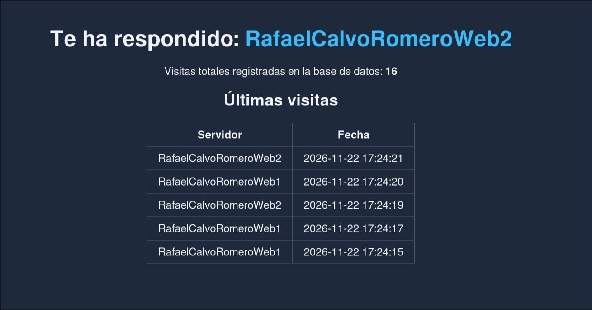

### IP fija para el balanceador

Elegiremos la ip 192.168.18.200

Haremos un ping para comprobar que nadie la esta usando

`ping -c 2 192.168.18.200` nos deberá 100% packet loss para comprobar que nadie tiene esta ip

En el vagrantfile cambiamos esta linea
`b.vm.network "public_network", bridge: ENV["BRIDGE_IF"]`
por esta

`b.vm.network "public_network", bridge: ENV["BRIDGE_IF"], ip: "192.168.18.200"`

Reiniciamos la maquina del balanceador
`vagrant reload balanceador`

Volvemos a entrar en la maquina y comprobamos con `ip -br a` si se cambio
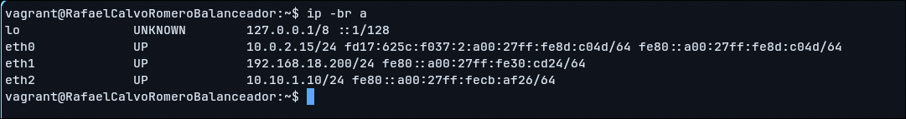

### Descargamos Cerbot
Pondremos este comando `sudo apt install -y certbot python3-certbot-apache`

Comprobaremos la instalación `cerbot --version`


### Subdominio DuckDNS

Entraremos en esta web [DuckDNS](https://www.duckdns.org/)
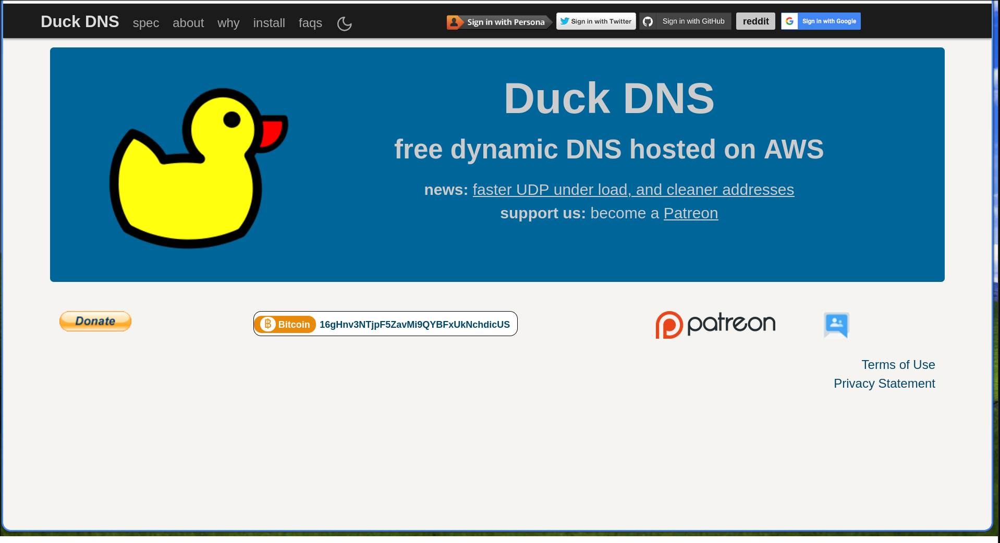
Iniciamos sesión y escribimos nuestro subdominio

Nos saldrá nuestra IP publica la borramos y la cambiamos por 192.168.18.200
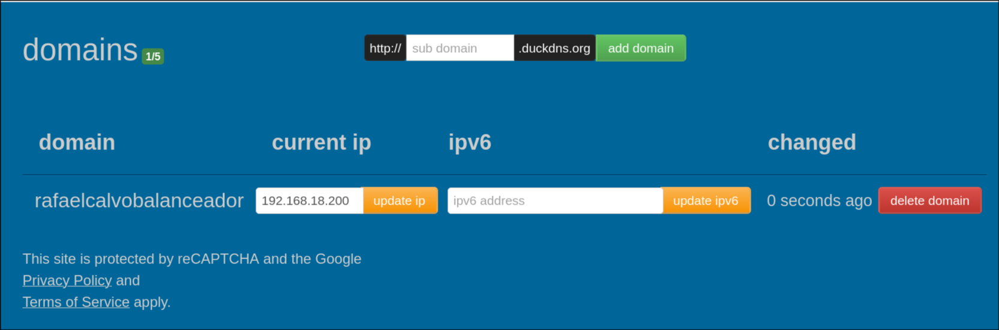
Comprobamos que funciona
`ping -c 2 rafaelcalvobalanceador.duckdns.org`


### Pedir certificado
En el terminal del balanceador pondremos los siguientes comandos
`sudo apt install -y dnsutils`
`sudo certbot certonly --manual --preferred-challenges dns -d rafaelcalvobalanceador.duckdns.org`

Te pedira un correo para avisarte cuando caduca el certifcado, Y, N, se para y te muestra un valor para el registro, abriremos otro terminal

Entramos con `vagrant ssh balanceador` y pondremos
`curl "https://www.duckdns.org/update?domains=rafaelcalvobalanceador&token=TU_TOKEN&txt=VALOR"`

Cambiando TU_TOKEN y VALOR, si todo esta bien te deberá responder con un OK luego de eso pondremos este comando 
`dig +short TXT _acme-challenge.rafaelcalvobalanceador.duckdns.org @ns1.duckdns.org`

Te responderá el valor entre comillas, cuando esto pase volvemos al terminal de cerbot y pulsamos `Enter`


### Configuración Apache HTTPS

Activamos el modulo SSL
`sudo a2enmod ssl`

Cambiamos la configuración del balanceador
`sudo nano /etc/apache2/sites-available/balanceador.conf`

```
<VirtualHost *:80>
    ServerName rafaelcalvobalanceador.duckdns.org
    Redirect permanent / https://rafaelcalvobalanceador.duckdns.org/
</VirtualHost>

<VirtualHost *:443>
    ServerName rafaelcalvobalanceador.duckdns.org

    SSLEngine on
    SSLCertificateFile    /etc/letsencrypt/live/rafaelcalvobalanceador.duckdns.org/fullchain.pem
    SSLCertificateKeyFile /etc/letsencrypt/live/rafaelcalvobalanceador.duckdns.org/privkey.pem

    <Proxy "balancer://webs">
        BalancerMember "http://10.10.1.11"
        BalancerMember "http://10.10.1.12"
        ProxySet lbmethod=byrequests
    </Proxy>

    ProxyPreserveHost On
    ProxyPass        "/" "balancer://webs/"
    ProxyPassReverse "/" "balancer://webs/"

    ErrorLog ${APACHE_LOG_DIR}/balanceador_error.log
    CustomLog ${APACHE_LOG_DIR}/balanceador_access.log combined
</VirtualHost>
```

Lo aplicamos

`sudo apache2ctl configtest`
`sudo systemctl reload apache2`

Lo comprobamos
`curl -sI http://localhost | head -n 3`
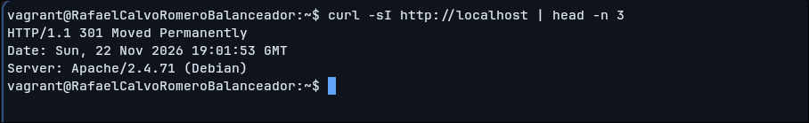

En el navegador
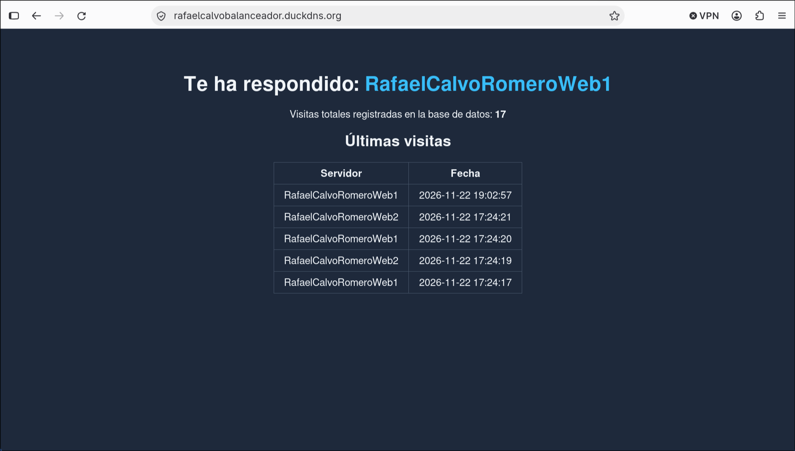


## Cortafuegos de la BBDD

Instalamos ufw
`sudo apt install -y ufw`

Pondremos las politicas por defecto
`sudo ufw default deny incoming`
`sudo ufw default allow outgoing`


Abrimos el puerto SSH para las conexiones
`sudo ufw allow in on eth0 to any port 22 proto tcp`
Permitimos la conexión de las webs
`sudo ufw allow in on eth1 from 10.10.2.0/24 to any port 3306 proto tcp`


Activamos el cortafuegos y comprobamos
`sudo ufw enable`
`sudo ufw status verbose`
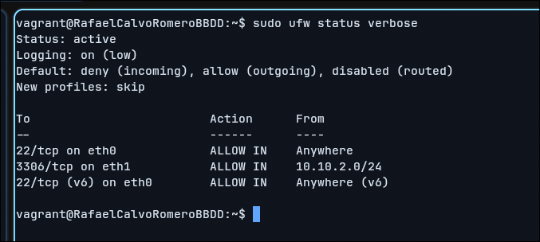
Entramos desde web1
`mariadb -h 10.10.2.20 -u usuario_web -p -e "SHOW TABLES FROM app_balanceador;"`
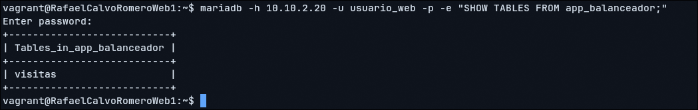

### Cortafuegos Web1 y Web2
**SE CONFIGURA EN LAS 2 TERMINALES**
```
sudo apt install -y ufw
sudo ufw default deny incoming
sudo ufw default allow outgoing
sudo ufw allow in on eth0 to any port 22 proto tcp
sudo ufw allow in on eth1 from 10.10.1.10 to any port 80 proto tcp
sudo ufw enable
sudo ufw status verbose
```

**Status web1**
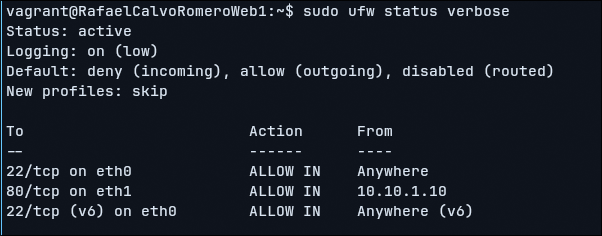
**Status web2**
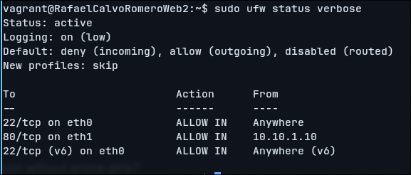

Todo debe seguir funcionando de forma correcta pero debe fallar esto
`curl -m 5 10.10.1.11` en web2 pedirle la página de web1
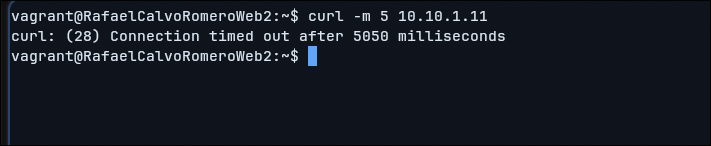

### Cortafuegos del Balanceador
```
sudo apt install -y ufw
sudo ufw default deny incoming
sudo ufw default allow outgoing
sudo ufw allow in on eth0 to any port 22 proto tcp
sudo ufw allow in on eth1 to any port 80 proto tcp
sudo ufw allow in on eth1 to any port 443 proto tcp
sudo ufw enable
sudo ufw status verbose
```
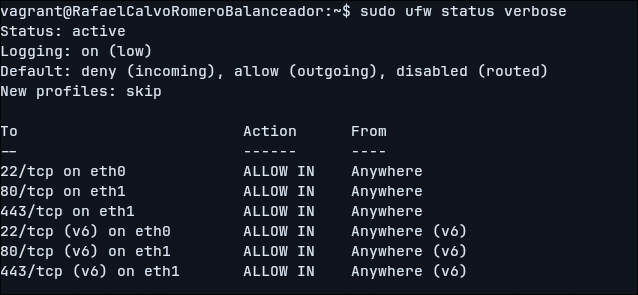
Todo debé funcionar como antes pero ahora no dejará entrar por ssh a el balanceador por su ip
`ssh -o ConnectTimeout=5 vagrant@192.168.18.200`
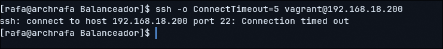

Aquí hay un video probando el funcionamiento de todo [video](https://youtu.be/VcqZOSquvg8)
