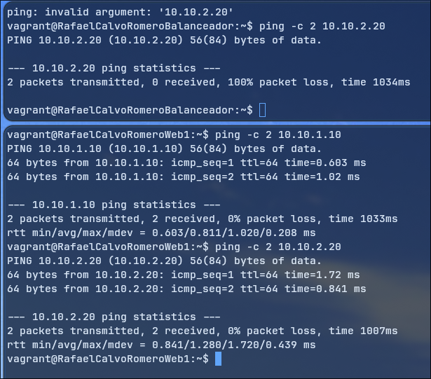
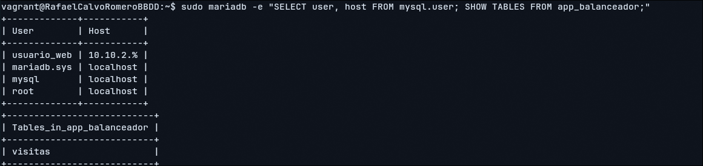

# Tarea Balanceador

## Vagrantfile
Creamos el **vagrantfile** especificando que vamos a crear 4 maquinas virtuales con Debian 12
- **Balanceador** Reparte las peticiones de los clientes entre web 1 y web 2
- **Web1 y Web2** Son los 2 servidores web son identicas, solo cambia el nombre y las IPs, por eso las creamos con un bucle
- **Base de datos** Se comparte con las 2 webs, para que los datos sean los mismo

#### Hacemos un `vagrant up` y luego un `vagrant status` y debería acabar así

### Conexión 

Nos conectamos por ssh a cada maquina de esta manera
`vagrant ssh "NOMBRE DE LA MAQUINA"`
El nombre de la maquina aparece en el vagrant status que hemos echo antes

Yo como uso el terminal de kitty me da algunos problemas con ssh entonces para poder usar clear y demás en la terminal de ssh pongo esto `export TERM=xterm-256color`

Hacemos un `ip -br a` para comprobar que todas las maquinas estan en las redes que necesitamos y esta todo en orden según hemos configurado en el vagrantfile

Haremos unos ping en web1 y en el balanceador
### Web1
`ping -c 2 10.10.1.10`
`ping -c 2 10.10.2.20`

### Balanceador
`ping -c 2 10.10.2.20`

Los de web 1 deberán funcionar correctamente y del balanceador fallará

## Base de datos`

En la maquina virtual de la base de datos instalaremos MariaDB

`sudo apt update`
`sudo apt install -y mariadb-server`

**Comprobación**
`systemclt status mariadb`

## Configuración red privada
Por defecto MariaDB solo acepta conexiones desde localhost esto es un problema porque las webs no se podrán conectar, la pondremos a escuchar su ip de red_bbdd

Entramos en este fichero `/etc/mysql/mariadb.conf.d/50-server.cnf` y buscamos esta linea
`bind-address            = 127.0.0.1` 
Cambiamos la ip de localhost por esta `10.10.2.20`

**REINICIAMOS MARIADB**
`sudo systemctl restart mariadb`

Hacemos la comprobación de que ha funcionado

En el terminal ponemos `sudo mariadb` dentro ejecutamos esto, cambiamos los asteriscos por una clave real
`CREATE DATABASE app_balanceador;`

`CREATE USER 'usuario_web'@'10.10.2.%' IDENTIFIED BY '********';`
`GRANT SELECT, INSERT ON app_balanceador.* TO 'usuario_web'@'10.10.2.%';`
`FLUSH PRIVILEGES;`
`USE app_balanceador;`
`CREATE TABLE visitas (`
`    id INT AUTO_INCREMENT PRIMARY KEY,`
`    servidor VARCHAR(50) NOT NULL,`
`    fecha DATETIME DEFAULT CURRENT_TIMESTAMP`
`);`
`EXIT;`
Comprobamos que todo esta en orden con este comando `sudo mariadb -e "SELECT user, host FROM mysql.user; SHOW TABLES FROM app_balanceador;"`

